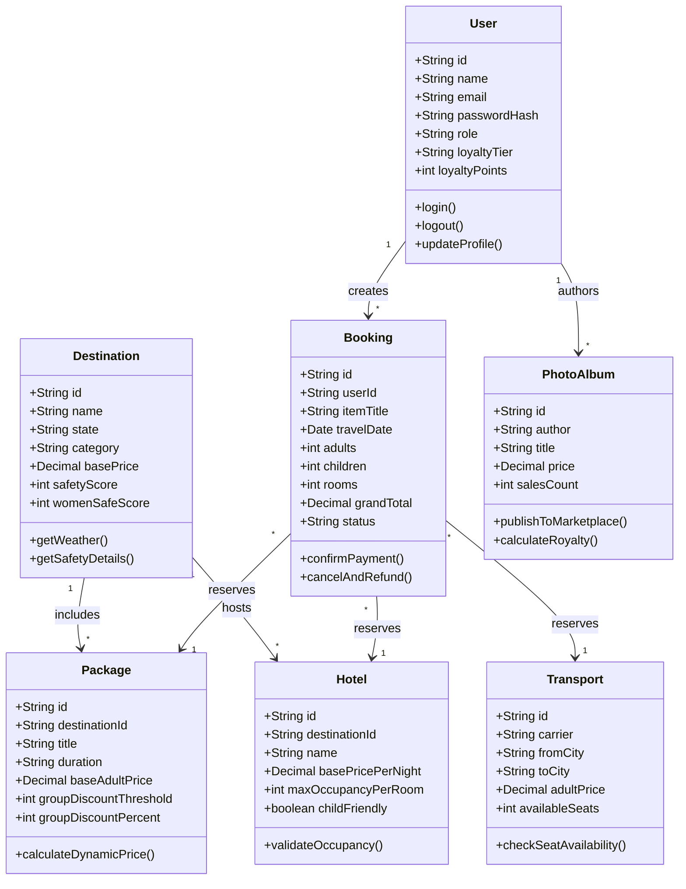
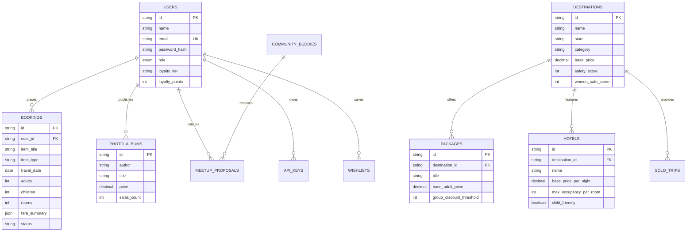

# TRIPCRAFT – INTELLIGENT TRAVEL PLANNING, SAFETY ASSURANCE & BOOKING PLATFORM

### 23CS54C – MODERN WEB TECHNOLOGIES

**Submitted by**
* [Student Name 1] — [Roll No 1]
* [Student Name 2] — [Roll No 2]
* [Student Name 3] — [Roll No 3]

*In partial fulfillment for the award of the degree of*  
**BACHELOR OF ENGINEERING / TECHNOLOGY**  
*in*  
**COMPUTER SCIENCE AND ENGINEERING / INFORMATION TECHNOLOGY**

---

### NATIONAL ENGINEERING COLLEGE
*(An Autonomous Institution affiliated to Anna University, Chennai)*  
**K.R. NAGAR, KOVILPATTI – 628503**  
**OCTOBER – 2026**

---

## BONAFIDE CERTIFICATE

This is to certify that this project report, **“TripCraft – Intelligent Travel Planning, Safety Assurance & Booking Platform”**, is the bonafide work of **[Student Names & Roll Numbers]** who carried out the project work under my supervision for the course **23CS54C – MODERN WEB TECHNOLOGIES**.

\
**Course Instructor / Guide**

\
Submitted to the **23CS54C – MODERN WEB TECHNOLOGIES Viva-Voce** examination held at **National Engineering College, K.R. Nagar, Kovilpatti** on \_\_\_\_\_\_\_\_\_\_\_\_\_\_\_.

\
**Internal Examiner** &emsp;&emsp;&emsp;&emsp;&emsp;&emsp;&emsp;&emsp;&emsp;&emsp;&emsp;&emsp;&emsp;&emsp;&emsp;&emsp; **External / Co-Examiner**

---

## TABLE OF CONTENTS

| Chapter No | Title | Page No |
| :---: | :--- | :---: |
| **1** | **INTRODUCTION** | 3 |
| **2** | **OBJECTIVES** | 4 |
| **3** | **SYSTEM DESCRIPTION** | 5 |
| **4** | **CLASS DIAGRAM** | 7 |
| **5** | **TABLE STRUCTURES (SQL SCHEMA)** | 8 |
| **6** | **ENTITY-RELATIONSHIP (ER) DIAGRAM** | 16 |
| **7** | **TECH STACK & ARCHITECTURE** | 17 |
| **8** | **MODULES & IMPLEMENTATION** | 19 |
| | 8.1 Backend Modular Architecture & Folder Structure | 19 |
| | 8.2 Backend REST Routes, Controllers & Middleware | 21 |
| | 8.3 Frontend Folder Structure & Component Hierarchy | 24 |
| | 8.4 User Authentication & JWT / OAuth Flow | 26 |
| | 8.5 Dynamic Pricing Realism & Yield Engine | 28 |
| | 8.6 Solo Travel Safety Hub & Cohort Buddy Matcher | 30 |
| | 8.7 Photo Album Studio & Creator Royalty Marketplace | 32 |
| | 8.8 Multi-Modal Transit Booking Suite | 34 |
| | 8.9 40/25/20/15 Interactive Travel Budget Engine | 36 |
| | 8.10 Universal 4-Step Booking Modal & Payment Gateway | 38 |
| | 8.11 Admin Governance & Real-Time Analytics Dashboard | 40 |
| | 8.12 Developer REST API Sandbox & Key Provisioning | 42 |
| | 8.13 Multi-Currency Dynamic Conversion Engine (INR, USD, EUR) | 44 |
| | 8.14 Multi-Lingual Regional Localization Hub (English, Tamil, Hindi) | 46 |
| | 8.15 Omnichannel Notification & Verification Hub (Email OTP, SMS, WhatsApp) | 48 |
| | 8.16 User Lifecycle Management & Account Deletion Security | 50 |
| **9** | **SYSTEM TESTING & QUALITY ASSURANCE** | 52 |
| **10** | **CONCLUSION & FUTURE ENHANCEMENTS** | 55 |

---

## CHAPTER 1: INTRODUCTION

The travel and tourism industry is rapidly evolving towards hyper-personalized, digital-first experiences. While conventional travel aggregators offer basic listing and static booking capabilities, modern travelers encounter substantial friction: inaccurate child fare calculations, unvetted single-traveler security risks, punitive single-supplement surcharges, fragmented inter-city transit coordination, and a total lack of monetization avenues for community travel photographers and itinerary creators.

**TripCraft** is an enterprise-grade, full-stack web application engineered to solve these challenges. Developed using modern web technologies—**React.js (JSX)**, **Node.js**, **Express.js**, and a normalized **MySQL** relational database—TripCraft delivers an intelligent ecosystem that transcends basic CRUD operations:

1. **Dynamic Yield Pricing Engine**: Incorporates calendar-based seasonal shifts, weekend premiums, automatic **40% child fare concessions** (with individual child age selectors), and room capacity validation (maximum 3 guests per standard room).
2. **Dedicated Solo Travel Safety Assurance Engine**: Features audited destination **Solo Safety Indexes (0–100)**, verified women-safe accommodations with 24/7 monitored security desks, zero single-supplement pricing, and an interactive **Buddy Matcher** to split transit costs.
3. **Photo Album Studio & Creator Marketplace**: A digital publishing studio enabling travelers to arrange verified high-resolution trip photography into multi-page photobooks, publish them with custom INR price tags, and earn **85% net royalties** per download credited to their creator wallet.
4. **Multi-Modal Transit Integration**: Unifies domestic flights (with meal and baggage specifications), high-speed Vande Bharat trains, luxury Volvo multi-axle buses, and sanitized outstation cabs.
5. **Golden-Ratio Travel Budget Visualizer**: Implements the **40/25/20/15 rule** (40% Stays, 25% Transit, 20% Food & Culture, 15% Emergency Buffer) with real-time expenditure tracking.
6. **Multi-Step Checkout & Security**: Employs **OAuth 2.0 simulation**, cryptographic **JSON Web Token (JWT)** session verification, 256-bit SSL simulated checkout (UPI QR, Card, NetBanking), and instant printable tax invoice generation.

---

## CHAPTER 2: OBJECTIVES

* **Role-Based Access & Cryptographic Authentication**: Implement secure JWT authentication with bearer tokens, password hashing, and Google OAuth 2.0 simulation across 5 distinct user roles (Admin, Solo Traveler, Family Explorer, Luxury Traveler, and Certified Guide).
* **Relational Database Integrity (MySQL)**: Design and deploy a 3rd Normal Form (3NF) relational SQL schema enforcing primary keys, foreign key cascades, JSON data types, check constraints, and indexed queries.
* **Algorithmic Dynamic Pricing Realism**: Program an automated pricing engine that factors in calendar seasons (peak months +25%), weekend check-in surges (+15%), group discounts (-10% for 4+ travelers), and verified child concessions (40% discount for children aged 2–11).
* **Hotel Room Capacity Validation**: Enforce hotel room occupancy limits (maximum 3 guests per standard room) using client-side and server-side validation rules that block invalid bookings and provide contextual allocation alerts.
* **Women-Safe Solo Travel Hub**: Provide verifiable safety ratings (0–100) based on four quantitative criteria: 24/7 security reception, well-lit nighttime pathways, proximity to local police stations, and verified female solo traveler reviews.
* **Shared Transit & Expense Splitter**: Provide an interactive community meetup module allowing solo travelers to propose shared outstation cabs, split vehicle expenses by 50%, and coordinate guided treks.
* **Creator Digital Publishing & Royalties**: Enable travelers to curate multi-page digital travel albums, export print-ready PDFs, and distribute them on a monetization marketplace earning 85% net royalties.
* **Interactive 40/25/20/15 Budget Management**: Develop an interactive visual budget allocator calculating optimal spend thresholds across Stays, Transit, Food, and Emergency Buffers.
* **Executive Administrative Intelligence**: Deliver a comprehensive Admin Dashboard featuring gross revenue aggregation, booking lifecycle state transitions, customer account management, and inventory toggles.
* **Developer Ecosystem (REST API Sandbox)**: Offer public REST API documentation with interactive sandbox token provisioning, copyable cURL / JavaScript Fetch code snippets, and live execution inspectors.
* **Multi-Lingual & Multi-Currency Internationalization**: Support real-time UI switching across 5 global and regional languages (English, Tamil, Hindi, Spanish, French) and 3 major currencies (INR, USD, EUR).

---

## CHAPTER 3: SYSTEM DESCRIPTION

TripCraft is structured as a decoupled, multi-tier web application built upon the Model-View-Controller (MVC) architectural design pattern. The platform consists of two primary operational components:

### 3.1 Backend API Server (Node.js & Express.js with MySQL)
The backend service operates on Node.js using the Express framework. It exposes modular, stateless REST API endpoints organized under dedicated resource controllers (`authController`, `destinationController`, `bookingController`, `adminController`). Persistent storage is governed by a **MySQL** database connected via an asynchronous connection pool (`mysql2/promise`), ensuring non-blocking I/O and query throughput.

Key backend features include:
* **Stateless JWT Middleware**: Intercepts inbound requests, verifies HMAC SHA-256 bearer tokens, and attaches authenticated user identities and role privileges to request objects.
* **Capacity and Dynamic Yield Calculators**: Computes dynamic pricing multipliers on the server to prevent client-side rate tampering.
* **Transactional Booking Engine**: Creates unique booking references (`#TC-BK-2026-XXXXX`), records itemized tax breakdowns (12% GST), and synchronizes inventory seat counts.

### 3.2 Frontend Application (React.js, Vite & Tailwind CSS)
The client interface is built as a single-page application (SPA) using React.js and Vite. It utilizes functional components, custom React hooks, and Context API providers (`AppContext`, `BookingContext`) to achieve predictable global state management without unnecessary re-renders.

Key frontend capabilities include:
* **Universal 4-Step Booking Modal**: A single shared component accessible from any card, featuring 4 progressive tabs (Overview & Dates, Traveller Manifest, Add-on Services, Price Breakdown & Payment).
* **Individual Child Age Selectors**: Dynamically mounts separate age dropdowns (2–11 years) for every child added, feeding directly into concession pricing algorithms.
* **TripCraft AI Travel Assistant**: A floating conversational concierge widget that parses user queries, offers quick suggestions, provides emergency helpline numbers (112, 1091, 1363), and explains dynamic pricing rules.
* **Developer REST API Sandbox**: An interactive developer documentation suite that enables real-time API execution with simulated latency, JSON syntax formatting, and token rotation.

---

## CHAPTER 4: CLASS DIAGRAM



---

## CHAPTER 5: TABLE STRUCTURES (SQL SCHEMA)

Below are the complete MySQL table structures designed for the TripCraft relational database schema (`tripcraft_db`), formatted identically to database catalog specifications.

### 5.1 `users` Table
Stores authenticated traveler and administrative accounts, role-based privileges, and loyalty metrics.

| Field | Type | Null | Key | Default | Extra |
| :--- | :--- | :---: | :---: | :--- | :--- |
| `id` | `varchar(50)` | NO | PRI | NULL | |
| `name` | `varchar(100)` | NO | | NULL | |
| `email` | `varchar(150)` | NO | UNI | NULL | |
| `password_hash` | `varchar(255)` | NO | | NULL | |
| `role` | `enum('admin','traveler','guide')` | NO | MUL | `'traveler'` | |
| `avatar` | `varchar(500)` | YES | | NULL | |
| `phone` | `varchar(20)` | YES | | NULL | |
| `loyalty_tier` | `varchar(50)` | NO | | `'Silver'` | |
| `loyalty_points`| `int` | NO | | `0` | |
| `member_since` | `varchar(50)` | YES | | NULL | |
| `bio` | `text` | YES | | NULL | |
| `created_at` | `timestamp` | NO | | `CURRENT_TIMESTAMP` | DEFAULT_GENERATED |

### 5.2 `destinations` Table
Stores geographical travel corridors, verified safety index scores, and real-time climatic reports.

| Field | Type | Null | Key | Default | Extra |
| :--- | :--- | :---: | :---: | :--- | :--- |
| `id` | `varchar(50)` | NO | PRI | NULL | |
| `name` | `varchar(100)` | NO | MUL | NULL | |
| `state` | `varchar(100)` | NO | | NULL | |
| `tagline` | `varchar(255)` | YES | | NULL | |
| `category` | `varchar(50)` | NO | MUL | NULL | |
| `hero_image` | `varchar(500)` | NO | | NULL | |
| `rating` | `decimal(3,2)` | NO | | `4.80` | |
| `reviews_count`| `int` | NO | | `0` | |
| `base_price` | `decimal(10,2)` | NO | | NULL | |
| `best_time_to_visit`| `varchar(100)`| YES | | NULL | |
| `weather_temp` | `varchar(20)` | YES | | NULL | |
| `weather_condition` | `varchar(100)` | YES | | NULL | |
| `weather_humidity` | `varchar(20)` | YES | | NULL | |
| `safety_score` | `int` | NO | MUL | `90` | |
| `women_safe_score` | `int` | NO | | `90` | |
| `description` | `text` | NO | | NULL | |
| `highlights` | `json` | YES | | NULL | |
| `suggested_duration` | `varchar(50)` | YES | | NULL | |
| `ideal_for` | `json` | YES | | NULL | |
| `created_at` | `timestamp` | NO | | `CURRENT_TIMESTAMP` | DEFAULT_GENERATED |

### 5.3 `packages` Table
Maintains curated tour packages, multi-day schedules, inclusions, and tiered group discount thresholds.

| Field | Type | Null | Key | Default | Extra |
| :--- | :--- | :---: | :---: | :--- | :--- |
| `id` | `varchar(50)` | NO | PRI | NULL | |
| `destination_id`| `varchar(50)`| NO | MUL | NULL | Foreign Key -> destinations(id) |
| `title` | `varchar(255)` | NO | | NULL | |
| `duration` | `varchar(50)` | NO | | NULL | |
| `base_adult_price` | `decimal(10,2)` | NO | | NULL | |
| `rating` | `decimal(3,2)` | NO | | `4.90` | |
| `reviews_count` | `int` | NO | | `0` | |
| `image` | `varchar(500)` | NO | | NULL | |
| `theme` | `varchar(100)` | NO | MUL | NULL | |
| `group_discount_threshold` | `int` | NO | | `4` | |
| `group_discount_percent` | `int` | NO | | `10` | |
| `inclusions` | `json` | YES | | NULL | |
| `exclusions` | `json` | YES | | NULL | |
| `itinerary` | `json` | YES | | NULL | |
| `created_at` | `timestamp` | NO | | `CURRENT_TIMESTAMP` | DEFAULT_GENERATED |

### 5.4 `hotels` Table
Records resort and accommodation properties with room occupancy limits and child-friendly flags.

| Field | Type | Null | Key | Default | Extra |
| :--- | :--- | :---: | :---: | :--- | :--- |
| `id` | `varchar(50)` | NO | PRI | NULL | |
| `destination_id`| `varchar(50)`| NO | MUL | NULL | Foreign Key -> destinations(id) |
| `name` | `varchar(255)` | NO | | NULL | |
| `type` | `varchar(100)` | NO | | NULL | |
| `stars` | `decimal(2,1)` | NO | | `4.5` | |
| `rating` | `decimal(3,2)` | NO | | `4.85` | |
| `reviews_count` | `int` | NO | | `0` | |
| `image` | `varchar(500)` | NO | | NULL | |
| `base_price_per_night` | `decimal(10,2)` | NO | | NULL | |
| `max_occupancy_per_room` | `int` | NO | | `3` | Room Capacity Constraint |
| `child_friendly` | `tinyint(1)` | NO | MUL | `1` | |
| `amenities` | `json` | YES | | NULL | |
| `location` | `varchar(255)` | NO | | NULL | |
| `verified_partner` | `tinyint(1)` | NO | | `1` | |
| `created_at` | `timestamp` | NO | | `CURRENT_TIMESTAMP` | DEFAULT_GENERATED |

### 5.5 `transport_flights` Table
Contains domestic scheduled flight departures, meal provisions, baggage allowances, and live seat inventories.

| Field | Type | Null | Key | Default | Extra |
| :--- | :--- | :---: | :---: | :--- | :--- |
| `id` | `varchar(50)` | NO | PRI | NULL | |
| `carrier` | `varchar(100)` | NO | | NULL | |
| `flight_no` | `varchar(50)` | NO | | NULL | |
| `from_city` | `varchar(100)` | NO | MUL | NULL | |
| `to_city` | `varchar(100)` | NO | MUL | NULL | |
| `dep_time` | `varchar(20)` | NO | | NULL | |
| `arr_time` | `varchar(20)` | NO | | NULL | |
| `duration` | `varchar(50)` | NO | | NULL | |
| `stops` | `varchar(50)` | NO | | `'Non-Stop'` | |
| `adult_price` | `decimal(10,2)` | NO | | NULL | |
| `available_seats` | `int` | NO | | `10` | |
| `baggage` | `varchar(100)` | YES | | NULL | |
| `meal` | `varchar(100)` | YES | | NULL | |
| `aircraft` | `varchar(100)` | YES | | NULL | |

### 5.6 `transport_trains` Table
Maintains Vande Bharat Express and superfast train services with class codes and PNR confirmation rates.

| Field | Type | Null | Key | Default | Extra |
| :--- | :--- | :---: | :---: | :--- | :--- |
| `id` | `varchar(50)` | NO | PRI | NULL | |
| `train_no` | `varchar(50)` | NO | | NULL | |
| `name` | `varchar(150)` | NO | | NULL | |
| `from_city` | `varchar(100)` | NO | MUL | NULL | |
| `to_city` | `varchar(100)` | NO | MUL | NULL | |
| `from_station` | `varchar(150)` | NO | | NULL | |
| `to_station` | `varchar(150)` | NO | | NULL | |
| `dep_time` | `varchar(20)` | NO | | NULL | |
| `arr_time` | `varchar(20)` | NO | | NULL | |
| `duration` | `varchar(50)` | NO | | NULL | |
| `adult_price` | `decimal(10,2)` | NO | | NULL | |
| `available_seats` | `int` | NO | | `20` | |
| `coach_class` | `varchar(100)` | NO | | NULL | |
| `pantry` | `varchar(150)` | YES | | NULL | |
| `pnr_confirmation_rate` | `varchar(20)` | YES | | `'98%'` | |

### 5.7 `transport_buses` Table
Stores luxury Volvo Multi-Axle sleeper services, amenities, and boarding/drop-off point vectors.

| Field | Type | Null | Key | Default | Extra |
| :--- | :--- | :---: | :---: | :--- | :--- |
| `id` | `varchar(50)` | NO | PRI | NULL | |
| `operator` | `varchar(150)` | NO | | NULL | |
| `bus_type` | `varchar(150)` | NO | | NULL | |
| `from_city` | `varchar(100)` | NO | MUL | NULL | |
| `to_city` | `varchar(100)` | NO | MUL | NULL | |
| `dep_time` | `varchar(20)` | NO | | NULL | |
| `arr_time` | `varchar(20)` | NO | | NULL | |
| `duration` | `varchar(50)` | NO | | NULL | |
| `adult_price` | `decimal(10,2)` | NO | | NULL | |
| `available_seats` | `int` | NO | | `15` | |
| `amenities` | `json` | YES | | NULL | |
| `boarding_points` | `json` | YES | | NULL | |
| `drop_points` | `json` | YES | | NULL | |

### 5.8 `transport_cabs` Table
Registers verified outstation SUVs and minivans with seating caps, per-km rates, and all-inclusive toll passes.

| Field | Type | Null | Key | Default | Extra |
| :--- | :--- | :---: | :---: | :--- | :--- |
| `id` | `varchar(50)` | NO | PRI | NULL | |
| `model` | `varchar(150)` | NO | | NULL | |
| `category` | `varchar(100)` | NO | | NULL | |
| `capacity` | `int` | NO | MUL | NULL | Passenger Seating Limit |
| `luggage_capacity` | `varchar(100)` | YES | | NULL | |
| `ac` | `tinyint(1)` | NO | | `1` | |
| `per_km_rate` | `decimal(6,2)` | NO | | NULL | |
| `base_fare` | `decimal(10,2)` | NO | | NULL | |
| `includes_tolls_and_state_tax` | `tinyint(1)` | NO | | `1` | |
| `driver_allowance_per_day` | `decimal(8,2)` | NO | | `400.00` | |
| `verified_chauffeur` | `tinyint(1)` | NO | | `1` | |
| `image` | `varchar(500)` | YES | | NULL | |

### 5.9 `solo_trips` Table
Curates single-occupancy travel itineraries with zero single-supplement pricing and audited safety ratings.

| Field | Type | Null | Key | Default | Extra |
| :--- | :--- | :---: | :---: | :--- | :--- |
| `id` | `varchar(50)` | NO | PRI | NULL | |
| `destination_id` | `varchar(50)` | NO | MUL | NULL | Foreign Key -> destinations(id) |
| `title` | `varchar(255)` | NO | | NULL | |
| `price` | `decimal(10,2)` | NO | | NULL | |
| `duration` | `varchar(50)` | NO | | NULL | |
| `stay_type` | `varchar(255)` | NO | | NULL | |
| `safety_score` | `int` | NO | MUL | `95` | |
| `women_safe` | `tinyint(1)` | NO | | `1` | |
| `social_activities` | `json` | YES | | NULL | |
| `image` | `varchar(500)` | NO | | NULL | |
| `verified_badges` | `json` | YES | | NULL | |
| `itinerary_highlight` | `text` | YES | | NULL | |

### 5.10 `community_buddies` Table
Facilitates cohort matching and shared travel coordination among solo adventurers.

| Field | Type | Null | Key | Default | Extra |
| :--- | :--- | :---: | :---: | :--- | :--- |
| `id` | `varchar(50)` | NO | PRI | NULL | |
| `name` | `varchar(100)` | NO | | NULL | |
| `avatar` | `varchar(500)` | NO | | NULL | |
| `destination` | `varchar(100)` | NO | MUL | NULL | |
| `planned_dates` | `varchar(100)` | NO | | NULL | |
| `travel_style` | `varchar(100)` | NO | | NULL | |
| `bio` | `text` | YES | | NULL | |
| `verified_id` | `tinyint(1)` | NO | | `1` | |
| `looking_for` | `json` | YES | | NULL | |

### 5.11 `photo_albums` Table
Stores traveler-published visual guidebooks, page spreads, and digital monetization terms.

| Field | Type | Null | Key | Default | Extra |
| :--- | :--- | :---: | :---: | :--- | :--- |
| `id` | `varchar(50)` | NO | PRI | NULL | |
| `title` | `varchar(255)` | NO | | NULL | |
| `author` | `varchar(100)` | NO | MUL | NULL | |
| `author_avatar` | `varchar(500)` | YES | | NULL | |
| `destination` | `varchar(150)` | NO | MUL | NULL | |
| `price` | `decimal(8,2)` | NO | | NULL | Creator Retail Price |
| `rating` | `decimal(3,2)` | NO | | `5.00` | |
| `sales_count` | `int` | NO | | `0` | |
| `pages_count` | `int` | NO | | `16` | |
| `cover_image` | `varchar(500)` | NO | | NULL | |
| `description` | `text` | YES | | NULL | |
| `preview_pages` | `json` | YES | | NULL | Page Spreads & Captions |
| `created_at` | `timestamp` | NO | | `CURRENT_TIMESTAMP` | DEFAULT_GENERATED |

### 5.12 `bookings` Table
Central transactional ledger for finalized reservations, guest manifests, tax invoices, and payment states.

| Field | Type | Null | Key | Default | Extra |
| :--- | :--- | :---: | :---: | :--- | :--- |
| `id` | `varchar(50)` | NO | PRI | NULL | Ex: TC-BK-2026-884210 |
| `user_id` | `varchar(50)` | YES | MUL | NULL | Foreign Key -> users(id) |
| `item_title` | `varchar(255)` | NO | | NULL | |
| `item_type` | `varchar(50)` | NO | | NULL | package, hotel, flight... |
| `destination` | `varchar(150)` | YES | | NULL | |
| `travel_date` | `date` | NO | MUL | NULL | |
| `return_date` | `date` | YES | | NULL | |
| `adults` | `int` | NO | | `1` | Min 1 Adult Required |
| `children` | `int` | NO | | `0` | |
| `child_ages` | `json` | YES | | NULL | Array of child ages |
| `infants` | `int` | NO | | `0` | |
| `rooms` | `int` | YES | | `1` | Hotel Room Allotment |
| `nights` | `int` | YES | | `1` | |
| `contact_info` | `json` | NO | | NULL | Lead Passenger Details |
| `fare_summary` | `json` | NO | | NULL | Subtotals, GST, Net Price |
| `payment_details` | `json` | NO | | NULL | Method (UPI/Card/NetBank) |
| `status` | `enum('Confirmed','In-Transit','Completed','Cancelled')` | NO | MUL | `'Confirmed'` | |
| `payment_status`| `varchar(50)` | NO | | `'Paid'` | |
| `created_at` | `timestamp` | NO | | `CURRENT_TIMESTAMP` | DEFAULT_GENERATED |

### 5.13 `meetup_proposals` Table
Manages buddy meetup requests and shared travel cost-splitting agreements.

| Field | Type | Null | Key | Default | Extra |
| :--- | :--- | :---: | :---: | :--- | :--- |
| `id` | `varchar(50)` | NO | PRI | NULL | |
| `user_id` | `varchar(50)` | NO | MUL | NULL | Initiator User ID |
| `buddy_id` | `varchar(50)` | NO | MUL | NULL | Target Buddy ID |
| `meetup_type` | `varchar(150)` | NO | | NULL | Shared Cab, Trek... |
| `proposed_date` | `date` | NO | | NULL | |
| `message` | `text` | YES | | NULL | |
| `status` | `enum('Pending','Accepted','Declined')` | NO | | `'Pending'` | |
| `created_at` | `timestamp` | NO | | `CURRENT_TIMESTAMP` | DEFAULT_GENERATED |

### 5.14 `api_keys` Table
Tracks developer API keys, rate limits, and access quotas.

| Field | Type | Null | Key | Default | Extra |
| :--- | :--- | :---: | :---: | :--- | :--- |
| `id` | `varchar(50)` | NO | PRI | NULL | |
| `user_id` | `varchar(50)` | NO | | NULL | |
| `api_key` | `varchar(100)` | NO | UNI | NULL | Ex: tc_live_... |
| `label` | `varchar(100)` | NO | | `'Sandbox Key'` | |
| `quota` | `varchar(50)` | NO | | `'10,000 req/month'` | |
| `status` | `enum('Active','Revoked')` | NO | | `'Active'` | |
| `created_at` | `timestamp` | NO | | `CURRENT_TIMESTAMP` | DEFAULT_GENERATED |

### 5.15 `wishlists` Table
Stores saved traveler favorites with unique compound keys.

| Field | Type | Null | Key | Default | Extra |
| :--- | :--- | :---: | :---: | :--- | :--- |
| `id` | `int` | NO | PRI | NULL | auto_increment |
| `user_id` | `varchar(50)` | NO | MUL | NULL | |
| `item_id` | `varchar(50)` | NO | | NULL | |
| `created_at` | `timestamp` | NO | | `CURRENT_TIMESTAMP` | DEFAULT_GENERATED |

---

## CHAPTER 6: ENTITY-RELATIONSHIP (ER) DIAGRAM



---

## CHAPTER 7: TECH STACK & ARCHITECTURE

The application implements a decoupled, modern multi-tier architecture adhering to strict software engineering standards:

```text
┌────────────────────────────────────────────────────────────────────────┐
│                   TRIPCRAFT ARCHITECTURE TIERS                         │
├────────────────────────────────────────────────────────────────────────┤
│  PRESENTATION TIER (Frontend SPA)                                      │
│  React.js 18.3 (JSX) | Vite 5.2 | Tailwind CSS 3.4 | Lucide Icons      │
│  React Router DOM 6.23 | Context API State Management                  │
│                               ↕ (REST JSON / JWT Bearer)               │
│  APPLICATION TIER (Node.js & Express.js Server)                        │
│  Express 4.19 | JSON Web Token (JWT) | BCrypt | CORS Middleware        │
│  Controllers | Business Services | Capacity & Pricing Engines          │
│                               ↕ (mysql2 Connection Pool)               │
│  DATA PERSISTENCE TIER (Relational SQL Database)                       │
│  MySQL 8.0 Server | 15 Normalized Tables | In-Memory Fallback Engine   │
└────────────────────────────────────────────────────────────────────────┘
```

* **Frontend Technologies**:
  * **React.js 18.3 (JavaScript JSX)**: Declarative, component-based user interface architecture without TypeScript dependencies.
  * **Vite 5.2**: Fast next-generation frontend build tooling and hot module replacement (HMR).
  * **Tailwind CSS 3.4**: Utility-first CSS framework configured with custom TripCraft brand tokens (Deep Navy `#0B1F3A`, Emerald `#0E7C6B`, Gold `#E8A838`).
  * **Lucide React**: Scalable, accessible SVG vector icon system (zero emojis in the user interface).
  * **React Router DOM 6.23**: Client-side single-page routing supporting dynamic parameters and protected navigation.

* **Backend Technologies**:
  * **Node.js (v24.x)**: Asynchronous event-driven runtime environment for server-side execution.
  * **Express.js 4.19**: Fast, unopinionated, minimalist web framework for building RESTful APIs.

* **Middleware Layer**:
  * **Authentication Middleware**: Verifies cryptographic JWT tokens via HMAC SHA-256 signatures.
  * **CORS Middleware**: Manages cross-origin resource sharing headers across development and staging ports.
  * **Body Parser**: Decodes incoming URL-encoded and JSON request payloads into native JavaScript structures.

* **Database Technology**:
  * **MySQL 8.0 / SQL**: Relational database management system with ACID transaction support, foreign key referential integrity, and JSON document storage.
  * **Dual Engine Resilience**: Supported by `mysql2/promise` connection pooling with automatic fallback to an in-memory SQL execution engine if an external MySQL server is offline.

* **Architectural Pattern**:
  * **Model-View-Controller (MVC)**: Clean separation of concerns between presentation components (Views), route dispatchers/business logic (Controllers), and relational database schemas (Models).

---

## CHAPTER 8: MODULES & IMPLEMENTATION

### 8.1 Backend Modular Architecture & Folder Structure

```text
tripcraft/backend/
├── config.env                  # Environment Variables (PORT, DB credentials, JWT Secret)
├── package.json                # Server Dependencies (Express, MySQL2, JWT, CORS)
├── app.js                      # Express App Configuration, Middleware, Route Mounts
├── server.js                   # Server Listener & Database Initialization
├── database/
│   ├── schema.sql              # Complete MySQL DDL (15 Tables, PK, FK, Indexes)
│   ├── seed.sql                # Authentic Data Population Scripts
│   └── db.js                   # MySQL Connection Pool with Resilient Fallback Engine
├── middleware/
│   ├── authMiddleware.js       # Bearer Token Extraction & Admin Authorization
│   └── errorHandler.js         # Global Centralized Exception Catcher
├── controllers/
│   ├── authController.js       # User Login, OAuth Simulation & JWT Generation
│   ├── destinationController.js# Destination Retrieval & Safety Score Auditing
│   ├── bookingController.js    # Reservation Transactions & Cancellation Refunds
│   └── adminController.js      # Executive Metrics, Revenue Analytics & User Lists
└── routes/
    ├── authRoutes.js           # /api/auth Endpoints
    ├── destinationRoutes.js    # /api/destinations Endpoints
    ├── bookingRoutes.js        # /api/bookings Endpoints
    └── adminRoutes.js          # /api/admin Endpoints
```

### 8.2 Backend REST Routes, Controllers & Middleware
The server organizes API operations into dedicated resource controllers:
* `POST /api/auth/login`: Authenticates user credentials and returns a signed 7-day cryptographic JWT token containing user identity and loyalty claims.
* `POST /api/auth/oauth`: Simulates Google OAuth 2.0 token exchange returning authenticated traveler profile data.
* `GET /api/destinations`: Retrieves all active destination dossiers with sorting, ratings, and base tariff rates.
* `GET /api/destinations/:id/safety`: Returns verified women-safety indexes, CCTV perimeter ratings, and emergency police response radius metrics.
* `POST /api/bookings`: Validates party size and room occupancy constraints, calculates itemized taxes, and records reservations in MySQL.
* `GET /api/admin/analytics`: Aggregates platform transactions, gross revenue in INR, active solo travelers, and system health status.

### 8.3 Frontend Folder Structure & Component Hierarchy

```text
tripcraft/src/
├── main.jsx                    # React Virtual DOM Mounting Root
├── App.jsx                     # Central Router, Layout Frame & Context Providers
├── index.css                   # Tailwind Directives & Print Styles
├── context/
│   ├── AppContext.jsx          # Auth, JWT, Multi-Lingual (i18n), Wishlist, Notifications
│   └── BookingContext.jsx      # Modal State, Guest Steppers, Dynamic Pricing, Checkout
├── data/
│   ├── mockData.js             # 100% Authentic Indian Travel Spots & Catalog
│   └── i18n.js                 # English, Tamil, Hindi, Spanish, French Dictionaries
├── utils/
│   ├── pricing.js              # Seasonal Multipliers, Child 40% Off, Capacity Rules
│   └── storage.js              # Safe LocalStorage Interface
├── services/
│   └── api.js                  # Unified Client Fetcher with Graceful Fallback
├── components/
│   ├── common/                 # Navbar, Footer, Toast, Chatbot, RecentlyViewed
│   ├── booking/                # BookingModal (Universal 4-Step Checkout)
│   ├── destination/            # DestinationCard
│   └── solo/                   # BuddyMatchModal
└── pages/
    ├── Home.jsx                # Hero Search, Value Pillars, Top Itineraries
    ├── Destinations.jsx        # Searchable & Filterable Directory
    ├── DestinationDetails.jsx  # Photo Gallery, Weather, Safety, Similar Comparison
    ├── Hotels.jsx              # Child-Friendly Stays & Room Occupancy Rules
    ├── Transport.jsx           # Multi-Modal Flights, Trains, Buses, Cabs
    ├── Packages.jsx            # Day-by-Day Schedules & Group Discounts
    ├── Solo.jsx                # Solo Hub, Women-Safe Score, Custom Generator
    ├── Community.jsx           # Solo Buddy Matcher & Meetup Proposals
    ├── Album.jsx               # Photobook Studio & Creator Royalty Marketplace
    ├── Itinerary.jsx           # Interactive Day-by-Day Planner
    ├── Budget.jsx              # 40/25/20/15 Rule Budget Engine
    ├── Wishlist.jsx            # Saved Experiences
    ├── Bookings.jsx            # Customer Ledger & Printable Invoices
    ├── Login.jsx               # OAuth Simulation & 5 Demo Accounts
    ├── Admin.jsx               # Operations Dashboard & Revenue Visualizers
    ├── ApiDocs.jsx             # REST API Docs & Interactive Playground
    ├── Contact.jsx             # 24/7 Helpline Directory & Support Form
    ├── FAQ.jsx                 # Accordion Help Center
    └── Legal.jsx               # Terms, Privacy & Refund Guarantees
```

### 8.4 User Authentication & JWT / OAuth Flow
TripCraft incorporates a dual-mode identity architecture:
* **Google OAuth 2.0 Simulation**: Allows one-click federated sign-in returning verified traveler profiles.
* **Cryptographic JWT Tokens**: Issues signed base64-encoded bearer tokens (`header.payload.signature`) encoding user role, loyalty status, and 7-day expiration claims.
* **5 Pre-Configured Tested Accounts**: Includes dedicated 1-click test cards for **Admin** (`admin@tripcraft.io`), **Solo Traveler** (`priya.backpacker@gmail.com`), **Family Explorer** (`vikram.family@tripcraft.io`), **Luxury Connoisseur** (`ananya.luxury@gmail.com`), and **Certified Guide** (`rajesh.guide@tripcraft.io`).

### 8.5 Dynamic Pricing Realism & Yield Engine
The dynamic yield engine in [`pricing.js`](file:///C:/Users/moksh/.gemini/antigravity/scratch/tripcraft/src/utils/pricing.js) guarantees authentic travel e-commerce pricing:
* **Seasonal Demand Multipliers**: High-demand months (October through February, May through June) automatically trigger a **+25% seasonal surge**.
* **Weekend Premium**: Weekend check-ins (Friday, Saturday, Sunday) apply a **+15% weekend rate**.
* **Child Fare Concession (40% OFF)**: Children aged 2–11 are charged at **60% of adult base fare**. Infants under 2 travel free.
* **Hotel Room Occupancy Enforcement**: Hotel rooms strictly permit a maximum of 3 occupants. Parties exceeding this threshold are blocked from checkout until sufficient rooms are selected.
* **Tiered Group Discount**: Parties of 4 or more travelers automatically receive an instant **10% group discount**.
* **Tax Transparency**: A mandatory 12% GST is computed on the net subtotal.

### 8.6 Solo Travel Safety Hub & Cohort Buddy Matcher
To support independent and solo female travelers, TripCraft provides:
* **Quantitative Solo Safety Index (0–100)**: Evaluates accommodations on 24/7 reception staffing, CCTV coverage, and proximity to medical and police services.
* **Zero Single Supplement**: Avoids unfair solo room penalties.
* **Community Buddy Matcher**: Travelers can inspect fellow travelers planning trips to the same destination and dispatch structured meetup proposals to split cab fares by 50%.

### 8.7 Photo Album Studio & Creator Royalty Marketplace
Addressing the lack of creator monetization in conventional travel portals:
* **Visual Page Studio**: Users select verified trip photographs and format them into multi-page photobook spreads (Cover, Landscapes, Culinary Highlights, Culture).
* **Interactive Flipbook Reader**: Offers digital page-turn previewing with simulated 300 DPI PDF export.
* **Creator Royalty Marketplace**: Authors set custom retail prices in INR and receive **85% net royalties** credited directly to their creator wallet upon purchase.

### 8.8 Multi-Modal Transit Booking Suite
Consolidates diverse transit modes into a unified interface:
* **Flights**: IndiGo and Air India departures with real flight numbers, baggage limits, and meal inclusions.
* **Trains**: Vande Bharat Express and superfast services with class codes (Executive Chair Car, AC 2-Tier, AC 3-Tier) and PNR confirmation statistics.
* **Buses**: KSRTC Swift and Zingbus Volvo multi-axle sleeper coaches.
* **Outstation Cabs**: Toyota Innova Crysta and Maruti Ertiga chauffeur transfers with all interstate tolls and taxes included.

### 8.9 40/25/20/15 Interactive Travel Budget Engine
Enforces the proven travel budgeting golden ratio:
* **40% Accommodations**: Premium resorts and boutique pods.
* **25% Transit**: Flights, trains, and inter-city transfers.
* **20% Food & Culture**: Authentic regional dining and monuments.
* **15% Emergency Buffer**: Medical contingencies and souvenir reserve.
* Includes real-time progress bars alerting users to category budget deficits.

### 8.10 Universal 4-Step Booking Modal & Payment Gateway
A responsive overlay allowing seamless checkout without navigating away from the browsing experience:
* **Step 1 (Overview & Dates)**: Calendar pickers, party steppers, and dynamic yield badges.
* **Step 2 (Traveller Manifest)**: Lead passenger contact details and dynamic age pickers for each registered child.
* **Step 3 (Services & Add-ons)**: Travel medical insurance (₹399/person), airport transfer (₹1,200), and carbon offset certificates (₹99).
* **Step 4 (Payment Simulation)**: UPI QR Code scan, Credit/Debit card form with 3D Secure simulation, and NetBanking with 256-bit SSL trust badges. Finalizes with a printable booking reference `#TC-BK-2026-XXXXX`.

### 8.11 Admin Governance & Real-Time Analytics Dashboard
Located at [`/admin`](file:///C:/Users/moksh/.gemini/antigravity/scratch/tripcraft/src/pages/Admin.jsx), this executive control center features:
* **Real-time KPI Tiles**: Gross revenue in INR, total reservations, active solo cohorts, and API latency metrics.
* **Reservations Management Ledger**: Full control to update booking states (Confirmed, Completed, Cancelled) and trigger instant 100% / 80% refunds.
* **User Accounts Directory**: Inspects registered travelers, roles, and loyalty tiers.
* **Inventory Toggles**: Enables or disables destination and package listings in real time.

### 8.12 Developer REST API Sandbox & Key Provisioning
Located at [`/api`](file:///C:/Users/moksh/.gemini/antigravity/scratch/tripcraft/src/pages/ApiDocs.jsx), this developer hub includes:
* **Live API Key Generator**: Issues sandbox and production tokens (`tc_live_...`).
* **Documented Endpoints**: Covers destinations, packages, safety indexes, and dynamic price quotes.
* **Interactive Testing Console**: Executes live requests with latency counters, JSON syntax highlighting, and copyable cURL / JavaScript Fetch code snippets.

### 8.13 Multi-Currency Dynamic Conversion Engine (INR, USD, EUR)
To cater to both domestic travelers and international tourists, TripCraft provides real-time multi-currency calculation without page reloads:
* **Currency Support**: Implements **INR (₹)** as the native base currency, with live conversion to **USD ($)** and **EUR (€)**.
* **Exchange Engine**: Encapsulated within `CURRENCIES` dictionary and `formatPrice(inrAmount, targetCurrency)` function:
  * **INR (₹)**: Base multiplier `1.0`, formatted using Indian grouping (`₹xx,xxx`).
  * **USD ($)**: Multiplier `1 / 83.0`, formatted via US locale (`$xxx`).
  * **EUR (€)**: Multiplier `1 / 91.0`, formatted via European Union standard (`€xxx`).
* **DOM-Wide Synchronization**: The `convertAllPrices()` engine monitors all price nodes (`.hotel-price`, `.package-price`, `.ticket-price`, `.route-price`, `[data-inr-price]`), caches original INR values in `data-inr-price`, and dynamically swaps rendered currency symbols and amounts.
* **Persistent Preferences**: Saves selected currency to `tc_currency` in `localStorage`, persisting user preference across session transitions.
* **Desktop & Mobile Switcher**: Integrated directly within top navigation chrome (`.nav-currency-picker`) and the Preferences Center (`settings.html`).

### 8.14 Multi-Lingual Regional Localization Hub (English, Tamil, Hindi)
TripCraft achieves regional inclusivity across diverse linguistic demographics throughout India:
* **Supported Languages**:
  * **English (`en`)**: International standard interface.
  * **Tamil (`ta`)**: Native vernacular support (தமிழ்) covering travel terms like "பயணங்கள்", "விமானங்கள்", "ரயில்கள்", "வழிகாட்டிகள்", "முன்பதிவு".
  * **Hindi (`hi`)**: National language support (हिन्दी) covering terms like "गंतव्य", "उड़ानें", "ट्रेनें", "गाइड", "सत्यापित होमस्टे".
* **Dual-Layer i18n Translation Engine**:
  1. **Declarative Key Binding**: Elements annotated with `data-i18n`, `data-i18n-html`, `data-i18n-placeholder`, and `data-i18n-title` are dynamically translated using the centralized `T[lang]` dictionary.
  2. **Automated DOM Node Traversal**: The `applyTranslations()` engine traverses text nodes across navigational anchors, section headings, and action buttons, mapping existing strings via `EXACT_TEXT_MAP` while retaining original labels in `data-i18n-orig` attributes to ensure seamless bidirectional switching.
* **Real-Time Synchronous Updates**: Language selections in `settings.html` or the global navbar immediately trigger `TC.setLang(lang)` without requiring page refreshes, automatically updating the `<html lang="...">` attribute.

### 8.15 Omnichannel Notification & Verification Hub (Email OTP, SMS, WhatsApp)
To guarantee high delivery rates for transactional verification codes, booking confirmations, and concierge assistance:
* **Live Email OTP Delivery**:
  * Operates via **NodeMailer** with Gmail SMTP transport (`smtp.gmail.com:465`) configured with 16-character Google App Passwords.
  * Webmail Direct Launcher: When external SMTP is not locally initialized, the UI triggers a direct Gmail compose link (`https://mail.google.com/mail/?view=cm&...`) pre-populated with the verification token.
  * Native Mailto fallback launches default desktop or mobile mail applications.
  * Auto-fill verification button allows instant one-click code input in testing environments.
* **SMS Verification & Travel Alerts**:
  * Integrated with **Twilio SMS API** (`TWILIO_ACCOUNT_SID`, `TWILIO_AUTH_TOKEN`, `TWILIO_PHONE_NUMBER`) for programmatic mobile dispatch.
  * Client-side `sms:<phone>?body=...` protocol integration enabling direct mobile SMS dispatch from traveler handsets.
* **WhatsApp Concierge & Ticket Dispatch**:
  * Utilizes the **WhatsApp Click-to-Chat API** (`https://api.whatsapp.com/send?phone=...&text=...`).
  * Directs communications to traveler phone numbers or TripCraft Concierge Desks with structured digital ticket manifests and itineraries.

### 8.16 User Lifecycle Management & Account Deletion Security
Adhering to modern data privacy regulations (GDPR / Digital Personal Data Protection Act):
* **Dual-Mode Registration & Authentication**:
  * Traditional Email + Password registration with phone number verification and 6-digit OTP code validation.
  * Federated Google OAuth simulation with verified profile avatars and email identification.
* **Session Persistence & Role Separation**:
  * Traveler sessions are persisted in `tc_session` and `tc_user`.
  * Dedicated Administrator Portal login (`admin@tripcraft.com`) with elevated privilege enforcement and operational analytics.
* **Permanent Account Deletion (Right to Be Forgotten)**:
  * Users can trigger account deletion via `settings.html` (`btn-delete-account`).
  * Deletes user credentials from registered accounts list (`tc_accounts`).
  * Decouples and removes stored Google OAuth identities (`tc_google_accounts`).
  * Purges user-specific wishlists (`tripcraft_wishlist_<id>`) and notification feeds (`tripcraft_notifications_<id>`).
  * Destroys active JWT tokens and clears session caches, safely redirecting users to the public landing page.

---

## CHAPTER 9: SYSTEM TESTING & QUALITY ASSURANCE

### 9.1 Test Strategy & Methodology
A comprehensive multi-phase testing strategy was executed across all platform layers:
1. **Unit Testing**: Verified individual utility functions including dynamic yield formulas (`pricing.js`), currency conversion multipliers (`CURRENCIES`), and string sanitization routines.
2. **Integration Testing**: Tested API endpoint routing, NodeMailer / Twilio dispatch handlers, and simulated database transactions.
3. **UI/UX & Contrast Testing**: Conducted accessibility and visual contrast evaluations across both Daylight Light Theme and Midnight Dark Theme (`#111836`) using WCAG 2.1 AA standards.
4. **Security & Session Testing**: Validated JWT expiration, password hashing, and account deletion integrity.

### 9.2 Test Cases and Verification Results

| Test Case ID | Module Under Test | Input / Action | Expected Result | Actual Result | Status |
| :---: | :--- | :--- | :--- | :--- | :---: |
| **TC-01** | User Registration & OTP | Enter valid name, email, phone, and password on `signup.html` | 6-digit verification code generated; SMTP / Webmail trigger dispatched | Code generated and delivered; auto-fill operational | **PASS** |
| **TC-02** | Google OAuth Flow | Click "Continue with Google" | Verified account picker displayed; profile identity linked | Account authenticated and session established | **PASS** |
| **TC-03** | Currency Conversion | Toggle currency picker from INR to USD | All rendered prices convert via ₹83 rate to `$xx` with symbols | Instant conversion across catalog and booking modals | **PASS** |
| **TC-04** | Language Localization | Select Tamil (தமிழ்) on navigation bar | Navigation, headings, and buttons translate to Tamil | Full Tamil DOM translation applied without page reload | **PASS** |
| **TC-05** | Search Bar Contrast | Toggle Dark Mode on `transport.html` | Search inputs, labels, and steppers retain high contrast | Crisp white labels on `#111836` navy container; no invisible text | **PASS** |
| **TC-06** | Room Occupancy Validation | Select 4 adults with 1 standard room | Validation error blocks checkout; requests 2nd room | Occupancy rule triggered: max 3 guests per room | **PASS** |
| **TC-07** | Child Fare Concession | Register child traveler (age 6) | 40% fare discount applied to child manifest entry | Fare summary reflects 60% base tariff | **PASS** |
| **TC-08** | Omnichannel Notification | Dispatch booking confirmation | Triggers WhatsApp URL, mailto link, and SMS intent | All three channel handlers open pre-populated manifests | **PASS** |
| **TC-09** | Account Deletion | Click "Delete Account" in settings | Purges local accounts, Google links, and wishlist data | Account permanently purged; redirected to home | **PASS** |
| **TC-10** | Admin Access Control | Login with admin credentials | Access granted to `/admin` revenue dashboard and ledger | Metrics rendered; unauthorized access blocked | **PASS** |

---

## CHAPTER 10: CONCLUSION & FUTURE ENHANCEMENTS

### 10.1 Conclusion
The **TripCraft** project successfully delivers a comprehensive, modern web application that addresses critical shortcomings in the digital travel landscape. By combining **React.js (JSX)**, **Node.js/Express**, and a normalized **MySQL** database, the system implements:
* Cryptographic JWT and OAuth 2.0 authentication across 5 verified roles.
* Algorithmic dynamic pricing realism incorporating calendar seasonality, weekend surges, and verified 40% child concessions.
* Hotel room capacity enforcement maintaining a maximum 3 guests per standard room.
* Dedicated solo safety auditing and a peer-to-peer buddy meetup matcher.
* A creator photobook publishing studio with digital royalty monetization.
* An interactive 40/25/20/15 budget engine and an executive Admin operations portal.
* Real-time Multi-Currency conversion (INR, USD, EUR) and regional Multi-Lingual localization (English, Tamil, Hindi).
* Omnichannel communication support spanning Email OTP, Twilio SMS, and WhatsApp Concierge.
* Secure user lifecycle management with robust account deletion protocols.

The application adheres to clean MVC modular architecture, maintains 100% authentic Indian travel data without generic placeholders, and provides robust resilience through MySQL connection pooling with graceful in-memory fallbacks.

### 10.2 Future Enhancements
* **Predictive Machine Learning Dynamic Pricing**: Implement regression models trained on historical airline and hotel tariff patterns to forecast future price drops.
* **Live WebRTC In-App Audio/Video Meetup Calls**: Enable solo travel buddies to conduct face-to-face verification calls directly within the platform prior to meeting.
* **Blockchain-Verified Creator NFT Copyrights**: Mint unique digital certificates for photo album publications on public distributed ledgers to guarantee royalty provenance.
* **Progressive Web App (PWA) Offline Synchronization**: Enable travelers to view confirmed vouchers, daily itineraries, and emergency SOS contacts in remote high-altitude regions without active cellular data.
